# AeroDesk — Enterprise Airline Management & Operations Control Platform

[](https://openjdk.org/)
[](https://maven.apache.org/)
[](https://www.mysql.com/)
[](https://docs.oracle.com/en/java/javase/17/docs/api/java.desktop/javax/swing/package-summary.html)

**AeroDesk** is a Java Swing desktop application for airline operations and commercial reservations, backed by MySQL through JDBC. Its implemented workflows include flight status operations, seat inventory controls, check-in, boarding-pass records, baggage tracking, Property Irregularity Reports (PIR), claims, and Irregular Operations (IROPS) service recovery. It is a development-stage system; production readiness has not been verified.

---

## Navigation

- [Executive Product Overview](#executive-product-overview)
- [Operational Workstations & Capabilities](#operational-workstations--capabilities)
- [Visual Interface & User Experience](#visual-interface--user-experience)
- [System Architecture](#system-architecture)
- [Role-Based Access Control (RBAC)](#role-based-access-control-rbac)
- [Technology Stack](#technology-stack)
- [Repository Structure](#repository-structure)
- [Prerequisites](#prerequisites)
- [Installation & Local Setup](#installation--local-setup)
- [Configuration & Environment Hierarchy](#configuration--environment-hierarchy)
- [Database & Schema Management](#database--schema-management)
- [Build, Execution & Test Verification](#build-execution--test-verification)
- [Security & Operational Safeguards](#security--operational-safeguards)
- [Current Maturity & Product Roadmap](#current-maturity--product-roadmap)
- [Contributing](#contributing)
- [License & Operational Disclaimer](#license--operational-disclaimer)

---

## Executive Product Overview

### The Operational Challenge
Commercial airline operations demand seamless coordination between passenger-facing desks and backend operations. In high-tempo airport environments, fragmented legacy tools frequently cause operational disconnects:
- **Concurrency Conflicts:** Simultaneous bookings on identical seats cause double-allocations and boarding disputes.
- **Data Desynchronization:** Flight delays or cancellations declared at dispatch fail to propagate instantly to gate agents and baggage handlers.
- **Service Recovery Inefficiencies:** When flights are disrupted, managing stranded passenger manifests, alternate rebookings, and meal/hotel amenity vouchers is often handled through manual spreadsheets.
- **Audit & Compliance Deficits:** Mishandled baggage claims (PIR) and ticket refunds frequently lack tamper-evident financial authorization trails.

### The AeroDesk Solution
AeroDesk bridges these gaps by providing an all-in-one desktop Operations Control Center (OCC). Built on transactional ACID principles and a modular layered design, AeroDesk enforces:
1. **Atomic Concurrency:** Database row locking (`SELECT ... FOR UPDATE`) and a generated stored column with a unique index prevent duplicate active seat allocations.
2. **Shared Operational Data:** Relational persistence connects flight, gate, baggage, and disruption workflows. Cross-panel consistency and real-time operational behavior have not been verified end to end.
3. **Structured Disruption Recovery:** The Irregular Operations (IROPS) engine compiles affected passenger manifests and enables one-click automated reaccommodation onto alternate flights with amenity voucher issuance.
4. **Role-Based Access:** The source defines eight roles and 23 permissions, with authorization checks in navigation and selected service operations.

### Application Model & Maturity
- **Current Deployment Model:** Single-instance Java 17 desktop application using JDBC and MySQL. Runtime, deployment, and operational performance have not been validated.
- **Architecture:** The application has separate UI, service, security, and persistence code, plus a multi-tenancy schema foundation. End-to-end tenant isolation and SaaS readiness require further verification.

---

## Operational Workstations & Capabilities

AeroDesk organizes airline operations into 15 dedicated workstation panels and modal workflows, accessible via a responsive navigation sidebar and top bar:

```
┌────────────────────────────────────────────────────────────────────────────────────────┐
│                                  AeroDesk Operations                                   │
├──────────────┬─────────────────────────────────────────────────────────────────────────┤
│ Navigation   │ Active Workstation Screen                                               │
│ ──────────── │ ────────────────────────────────────────────────────────────────────────│
│ • Dashboard  │  [Operations Overview & Fleet Key Performance Indicators]               │
│ • Flights    │  [Scheduled Flight Tracking, Gate Allocations & Dispatch Lifecycle]     │
│ • Booking    │  [Commercial Ticketing, Seat Map Allocation & Payment Recording]        │
│ • Passengers │  [Passenger Profiles, Travel History & Identity Verification]           │
│ • Check-in   │  [Counter Check-in, Seat Confirmation & Boarding Pass Generation]       │
│ • Boarding   │  [Gate Boarding Monitor, Pass Validation & Manifest Balancing]          │
│ • Baggage    │  [10-Digit IATA Bag Tag Generation, Container Routing & Event Scans]    │
│ • PIR Claims │  [Property Irregularity Reports & Baggage Compensation Settlements]     │
│ • IROPS Desk │  [Flight Disruption Declaration, Manifest Reaccommodation & Vouchers]   │
│ • Trips      │  [Passenger Journey Records, Itinerary Viewer & Digital Barcode Strip]  │
│ • Payments   │  [Financial Settlement Audit, Method Auditing & Ledger Reconciliation]  │
│ • Cancel     │  [Ticket Cancellations, Penalty Computations & Seat Inventory Recovery] │
│ • Reports    │  [Operational Analytics, On-Time Performance & Multi-Category CSV]      │
│ • Staff      │  [Staff User Accounts, Role Assignments & Administrative Safeguards]    │
│ • Settings   │  [Live Database Catalog Inspection, Connection Metadata & Audit Logs]   │
└──────────────┴─────────────────────────────────────────────────────────────────────────┘
```

### Detailed Capability Matrix

| Operational Domain | Status | Key Features & Source Implementation |
| :--- | :---: | :--- |
| **Authentication & Session** | **Implemented** | PBKDF2-HMAC-SHA256 password hashing (120,000 iterations, 16-byte salt, 256-bit result) via [`PasswordUtils`](main/src/airline/management/system/PasswordUtils.java). Legacy SHA-256 hashes are accepted but are not automatically upgraded on sign-in. Session tracking is in [`UserSession`](main/src/airline/management/system/UserSession.java). Startup schema pre-flight inspection is in [`SchemaPreflightGuard`](main/src/airline/management/system/database/SchemaPreflightGuard.java). |
| **Role-Based Access Control** | **Implemented** | 8 operational roles, 23 granular permissions mapped in [`RolePermissions`](main/src/airline/management/system/security/RolePermissions.java) and enforced at UI and service boundaries via [`AuthorizationService`](main/src/airline/management/system/security/AuthorizationService.java). "Last Active Administrator" protection in [`StaffService`](main/src/airline/management/system/staff/StaffService.java). |
| **Multi-Tenancy Foundation** | **Foundation implemented; end-to-end isolation unverified** | [`TenantContext`](main/src/airline/management/system/tenant/TenantContext.java) carries an organization context, and `organization_id` columns, indexes, and foreign keys are introduced for core tables by [`v3_phase14_multitenant_schema.sql`](database/v3_phase14_multitenant_schema.sql). Several services scope queries or check record ownership, but every data-access path has not been audited for isolation. |
| **Flight Operations & Dispatch** | **Implemented** | Status lifecycle state machine (`SCHEDULED` ➔ `BOARDING` ➔ `DEPARTED` ➔ `ARRIVED` / `DELAYED` / `CANCELLED`) in [`FlightOperationsService`](main/src/airline/management/system/operations/flight/FlightOperationsService.java). Gate allocation and conflict detection in [`GateService`](main/src/airline/management/system/operations/gate/GateService.java). Audited transitions in `flight_status_history`. |
| **Station Context Filtering** | **Partially Implemented** | Active operational station selector in [`TopBarPanel`](main/src/airline/management/system/ui/layout/TopBarPanel.java) updates station context labels in [`DashboardPanel`](main/src/airline/management/system/ui/panels/DashboardPanel.java) through in-memory [`StationContext`](main/src/airline/management/system/ui/layout/StationContext.java). Flight queries are not station-filtered: the schema stores free-form `source` and `destination` strings, with no reliable station-code relationship. |
| **Commercial Reservations** | **Implemented** | Atomic booking transaction with `SELECT ... FOR UPDATE` flight locking in [`ReservationService`](main/src/airline/management/system/ReservationService.java). PNR generation with collision retries. Enforces generated stored column `active_seat_number` and unique constraint `uq_active_flight_seat` ([`migration_3b.sql`](database/migration_3b.sql)). |
| **Counter Check-in & Boarding Passes** | **Implemented** | PNR lookup, passenger eligibility validation, and seat confirmation in [`CheckinServiceImpl`](main/src/airline/management/system/operations/checkin/CheckinServiceImpl.java). Automated generation of `boarding_passes` with unique 10-character pass codes, sequence numbers, and cryptographic QR/barcode payloads. |
| **Gate Operations & Boarding** | **Implemented** | Boarding pass validation scanner in [`BoardingServiceImpl`](main/src/airline/management/system/operations/boarding/BoardingServiceImpl.java). Validates flight status (`BOARDING`), prevents duplicate boardings, and reconciles passenger manifests (booked vs checked-in vs boarded). Logs events in `boarding_events`. |
| **Baggage Logistics & Tracking** | **Implemented** | 10-digit bag-tag generation (`0` + 2-digit airline prefix + 7 sequential digits) in [`BaggageServiceImpl`](main/src/airline/management/system/operations/baggage/BaggageServiceImpl.java). Container assignment, weight tracking, and lifecycle updates (`REGISTERED` ➔ `ACCEPTED` ➔ `LOADED` ➔ `IN_TRANSIT` ➔ `DELIVERED` ➔ `DELAYED` ➔ `MISSING`). IATA compliance has not been verified. |
| **PIR & Baggage Claims** | **Implemented** | Property Irregularity Report intake with 10-character reference numbers (`PIR-` + 6 hex) for lost or damaged luggage in [`PIRServiceImpl`](main/src/airline/management/system/operations/pir/PIRServiceImpl.java). Formal claim lifecycle tracking (`FILED` ➔ `UNDER_INVESTIGATION` ➔ `SETTLEMENT_OFFERED` ➔ `APPROVED` / `REJECTED` ➔ `SETTLED`) in [`ClaimServiceImpl`](main/src/airline/management/system/operations/claim/ClaimServiceImpl.java). |
| **Irregular Operations (IROPS)** | **Implemented** | Disruption event logging with severity classification in [`DisruptionServiceImpl`](main/src/airline/management/system/operations/irops/DisruptionServiceImpl.java). Dynamic affected passenger manifest extraction in [`AffectedPassengersDialog`](main/src/airline/management/system/ui/panels/AffectedPassengersDialog.java). One-click auto-reaccommodation engine finding available seats in [`ReaccommodationEngine`](main/src/airline/management/system/operations/irops/ReaccommodationEngine.java). Recovery amenity vouchers (`HOTEL`, `MEAL`, `TRANSPORT`) in [`DisruptionVoucherServiceImpl`](main/src/airline/management/system/operations/irops/DisruptionVoucherServiceImpl.java). |
| **Financials, Cancellations & Refunds** | **Implemented** | Multi-modal payment recording (UPI, Card, Cash) in `payments`. Cancellation processing in [`ReservationService`](main/src/airline/management/system/ReservationService.java) atomically releases seats, increments flight capacity, records penalty/refund breakdowns in `cancellations`, and audits actions. |
| **Operational Intelligence & Reports** | **Implemented** | Multi-category SQL metrics across 8 domains in [`OperationalReportService`](main/src/airline/management/system/operations/report/OperationalReportService.java). Filterable by date, flight, and status. One-click CSV export utility. |
| **External Payment Gateways** | **Planned** | Real-time REST payment gateways (Stripe, Razorpay, PayPal) to replace simulated local ledger transactions. |
| **Hardware Device Integration** | **Planned** | Native USB/COM-port serial scanner integration and ESC/POS thermal baggage tag printers. |
| **Passenger Disruption Messaging** | **Planned** | External SMS/Email notifications (Twilio, SendGrid) to dispatch vouchers automatically to passenger mobile numbers. |

---

## Visual Interface & User Experience

AeroDesk features a modern enterprise design system implemented entirely in Java Swing without third-party look-and-feels:
- **Design Tokens:** Clean, high-contrast palette ([`AeroColors`](main/src/airline/management/system/ui/theme/AeroColors.java)) with deep slate surfaces (`#0F172A`), neutral card backgrounds (`#FFFFFF`, `#F8FAFC`), and vibrant operational accents (`#0EA5E9` Sky Blue, `#10B981` Emerald Success, `#EF4444` Crimson Alert).
- **Custom Scrollbars ([`AeroScrollPane`](main/src/airline/management/system/ui/components/AeroScrollPane.java)):** Custom lightweight scrollable viewports styled to match the application interface.
- **Dynamic Feedback:** Context-aware status badges ([`StatusBadge`](main/src/airline/management/system/ui/components/StatusBadge.java)), notification banners with auto-dismiss timers ([`NotificationBanner`](main/src/airline/management/system/ui/components/NotificationBanner.java)), and dynamic action-button toggling based on row selection.
- **Asynchronous Execution:** Heavy queries and reporting aggregations execute on background `SwingWorker` threads, preventing UI lockups and keeping the Event Dispatch Thread (EDT) responsive.

No product screenshots or workflow recordings are included in this repository.

---

## System Architecture

AeroDesk has a layered structure spanning five architectural areas:

```mermaid
flowchart TD
    subgraph PresentationLayer ["Presentation Layer (Swing / AWT)"]
        UI_Login["Login Screen & Pre-flight Diagnostics"]
        UI_Nav["Sidebar & TopBar Station Switcher"]
        UI_Panels["15 Operational Card Consoles & Modal Dialogs"]
        UI_Widgets["Custom Components (AeroScrollPane, StatusBadge, StyledTable)"]
    end

    subgraph SecurityLayer ["Security & Context Infrastructure"]
        AuthSvc["Authentication & UserSession"]
        RBAC["RolePermissions (8 Roles, 23 Permissions)"]
        TenantCtx["TenantContext (ThreadLocal Multi-Tenancy)"]
        Preflight["SchemaPreflightGuard (Startup Metadata Inspector)"]
        TestGuard["TestDatabaseGuard (Fail-Closed Test Harness)"]
    end

    subgraph ServiceLayer ["Domain Services & Business Engine"]
        FlightOps["FlightOperationsService & GateService"]
        ResOps["ReservationService (Booking, Seat Locks, Cancellations)"]
        PaxOps["CheckinService & BoardingService"]
        BagOps["BaggageService & PIRService"]
        ClaimOps["ClaimService & DisruptionService"]
        ReaccomOps["ReaccommodationEngine & DisruptionVoucherService"]
        StaffOps["StaffService & PasswordUtils"]
        ReportOps["OperationalReportService & AuditService"]
    end

    subgraph PersistenceLayer ["Data Access & JDBC Layer"]
        DBConfig["DatabaseConfig (Hierarchy & Precedence Engine)"]
        DBConn["DBConnection (JDBC Connection Factory)"]
        PrepStmt["Parameterized JDBC Queries (ACID Transactions)"]
    end

    subgraph StorageLayer ["Relational Storage Layer"]
        DB_Prod[("Configured MySQL catalog")]
        DB_Test[("Separate test catalog: project4test")]
    end

    PresentationLayer --> SecurityLayer
    SecurityLayer --> ServiceLayer
    ServiceLayer --> PersistenceLayer
    PersistenceLayer --> StorageLayer
```



### Architectural Layer Responsibilities
1. **Presentation Layer:** Renders workstation consoles using Java Swing. Handles user input, fires asynchronous tasks to worker threads, and dispatches UI updates onto the Swing Event Dispatch Thread (EDT).
2. **Security & Context Layer:** Navigation and selected service operations check permissions. Tenant context is available to data-access code; test database protection applies to test paths that invoke `TestDatabaseGuard`.
3. **Domain Service Layer:** Houses business state machines (flight status transitions, booking validations, baggage lifecycles, IROPS reaccommodation logic, claim settlements). Transactional workflows use JDBC transactions where implemented.
4. **Data Access & Persistence Layer:** Manages JDBC connections, parameter binding via `PreparedStatement`, transaction commits and rollbacks, and configuration resolution.
5. **Storage Layer:** MySQL relational database with foreign keys and indexes defined by the supplied schema. The project does not pin a MySQL server version.

---

## Role-Based Access Control (RBAC)

The source defines eight roles and 23 permissions in [`RolePermissions`](main/src/airline/management/system/security/RolePermissions.java). Navigation visibility and service authorization use this matrix; the permissions listed here are not a claim that every screen action is gated identically.

| Operational Role | Permissions defined in source |
| :--- | :--- |
| **SUPERADMIN** | All defined permissions |
| **AIRLINEADMIN** | All defined permissions |
| **OPERATIONSMANAGER** | Dashboard, flights, flight operations, gates, reports, baggage, PIR, claims, claim review, disruptions, reaccommodation, disruption vouchers |
| **GATEAGENT** | Dashboard, boarding, gates, passenger check-in, boarding-pass issue, disruption viewing |
| **CHECKINAGENT** | Dashboard, passengers, passenger check-in, boarding-pass issue, baggage, PIR, disruption viewing |
| **RESERVATIONAGENT** | Dashboard, passengers, reservations, payments, cancellations, disruption viewing, reaccommodation |
| **FINANCEOFFICER** | Dashboard, payments, cancellations, reports, claim review, claim settlements, disruption viewing, disruption vouchers |
| **AUDITOR** | Dashboard, reports, audit logs, disruption viewing |

### Administrative Account Safeguard
The `StaffService` enforces an immutable **"Last Active Administrator"** rule:
- The system checks active administrator counts before any role modification or deactivation.
- Any attempt to downgrade or disable the sole remaining active administrator triggers an immediate `IllegalStateException("The last active administrator cannot be removed/disabled.")`.
- Operators cannot deactivate their own currently authenticated user account.

---

## Technology Stack

| Layer | Technology | Version | Purpose & Verification Evidence |
| :--- | :--- | :---: | :--- |
| **Runtime** | Java SE | `17+` | Java records, pattern matching, and `java.time` APIs. (`pom.xml`: `<maven.compiler.release>17</maven.compiler.release>`) |
| **UI Toolkit** | Java Swing & AWT | Standard | High-DPI desktop client, double-buffered graphics rendering, custom vector styling. |
| **Build Tool** | Apache Maven | Not pinned in `pom.xml` | Build automation, artifact compilation, shaded packaging. |
| **Packaging** | Maven Shade Plugin | `3.6.0` | Assembles self-contained executable Uber-JAR with manifest configuration and service transformations. |
| **Database** | MySQL | Version not pinned in the project | Relational storage for application data. Use a version compatible with the included schema and Connector/J. |
| **JDBC Driver** | MySQL Connector/J | `8.4.0` | Official high-performance Type-4 JDBC driver bundled into shaded JAR. |
| **Testing** | JUnit Jupiter | `5.11.4` | Automated unit, architecture, and integration test execution. |
| **Test Runner** | Maven Surefire | `3.5.2` | Test execution plugin configured with fail-closed safety parameters. |
| **Security** | PBKDF2-HMAC-SHA256 | Java Cryptography API | 120,000 iterations, 16-byte random salts, 256-bit derived results; hash comparison uses `MessageDigest.isEqual`. |

---

## Repository Structure

```
Airline Reservation System/
├── .gitignore                                  # Git ignore rules protecting secrets, dumps, & build targets
├── README.md                                   # Root enterprise product documentation (this document)
├── database/                                   # Authoritative relational SQL schemas and migration scripts
│   ├── schema.sql                              # 1. Base normalized tables (flights, passengers, reservations)
│   ├── migration_3b.sql                        # 2. Virtual stored column & active seat unique constraint
│   ├── v2_phase11_operations_schema.sql        # 3. Operations, aircraft fleet, gates, check-in, RBAC
│   ├── v3_phase14_multitenant_schema.sql       # 4. Multi-tenant organizations table & ownership columns
│   ├── v4_phase15_baggage_schema.sql           # 5. Baggage handling events & load reconciliation schema
│   ├── v5_phase16_pir_claims_schema.sql        # 6. Property Irregularity Reports & claims settlement schema
│   ├── v6_phase17_irops_schema.sql             # 7. Irregular operations, reaccommodation & voucher schema
│   ├── migration.sql                           # Optional legacy database record import utility
│   └── seed.sql                                # Optional local demo account and sample routes
├── docs/                                       # Technical specifications & milestone reports
│   ├── ARCHITECTURE.md                         # Detailed multi-layer technical architectural specification
│   └── PROJECT_COMPLETION_REPORT.md            # Development milestone report
└── main/                                       # Maven Java application module
    ├── pom.xml                                 # Maven dependencies, compiler, & shade configuration
    ├── .gitignore                              # Module-level ignore rules (target/, config.properties)
    ├── config.example.properties               # Sanitized template for database connection parameters
    ├── README.md                               # Module-level developer quickstart
    ├── run-aerodesk-test.ps1                   # Safe PowerShell test launcher (-DDB_NAME=project4test)
    └── src/
        ├── airline/management/system/          # Core application & Swing UI source tree
        │   ├── audit/                          # Audit logging services & compliance models
        │   ├── database/                       # Startup SchemaPreflightGuard metadata inspector
        │   ├── operations/                     # Domain modules (baggage, boarding, checkin, claims, irops, etc.)
        │   ├── security/                       # RBAC engine, Role, Permission, AuthorizationService
        │   ├── staff/                          # Staff account administration & password utilities
        │   ├── tenant/                         # Multi-tenant context & schema migration utilities
        │   └── ui/                             # Swing presentation layer (components, layout, panels, theme)
        └── test/java/airline/management/system # Test sources and database safety guard
```

---

## Prerequisites

Before building and running AeroDesk, verify that your environment satisfies the following requirements:

1. **Java Development Kit (JDK):**
   - Version: **JDK 17 or higher**, matching the compiler release configured in `main/pom.xml`.
   - Verify via CLI: `java -version` and `javac -version`.
2. **Apache Maven:**
   - Maven is required; `pom.xml` does not specify a minimum Maven version.
   - Verify via CLI: `mvn -version`.
3. **Database Server:**
   - MySQL with a local development catalog. The repository does not pin a server version.
   - Schema setup requires DDL privileges; normal application use requires the database privileges needed by the enabled workflows.
4. **Operating System:**
   - Primary: **Windows 10 / 11 (64-bit)**.
   - Other desktop operating systems may support Swing, but cross-platform GUI behavior has not been verified for this project.

---

## Installation & Local Setup

Follow these reproducible steps to set up, initialize, and execute AeroDesk on a local workstation.

### Step 1: Clone the Repository
```powershell
git clone https://github.com/Himanshusekharsahoo/Airline-Reservation-System.git
cd "Airline-Reservation-System"
```

### Step 2: Initialize Database Catalogs
Use a disposable, local MySQL instance for this setup. The application defaults to the catalog name `project4`; that name is also used in project documentation as the production catalog. Do not point these setup steps at a shared or operational server.

### Step 3: Apply Database Migrations in Sequence
From the repository root, apply the base and operational schema scripts to a disposable local development catalog in this order. The base schema creates `project4`; the following commands select it explicitly. These commands use PowerShell pipeline input, not `cmd.exe` redirection:
```powershell
# 1. Base normalized relational tables (flights, passengers, reservations, payments, cancellations)
Get-Content -Raw "database/schema.sql" | mysql -u root -p

# 2. Virtual stored column for active seat unicity
Get-Content -Raw "database/migration_3b.sql" | mysql -u root -p project4

# 3. RBAC, aircraft fleet, gates, check-in, boarding passes, and audit logs
Get-Content -Raw "database/v2_phase11_operations_schema.sql" | mysql -u root -p project4

# 4. Multi-tenant core schema (organizations & organization_id keys)
Get-Content -Raw "database/v3_phase14_multitenant_schema.sql" | mysql -u root -p project4

# 5. Baggage handling & tracking events
Get-Content -Raw "database/v4_phase15_baggage_schema.sql" | mysql -u root -p project4

# 6. Property Irregularity Reports & claims management
Get-Content -Raw "database/v5_phase16_pir_claims_schema.sql" | mysql -u root -p project4

# Optional: local development seed account and sample routes
Get-Content -Raw "database/seed.sql" | mysql -u root -p project4
```

`database/migration.sql` is an optional legacy-data import, not a required schema migration. It imports from legacy tables and contains `USE project4`.

> [!WARNING]
> Several scripts contain a hard-coded `USE project4`. The IROPS schema script is marked for `project4test` and does not select a catalog itself, while the startup guard requires its tables. The repository therefore does not currently provide a safe, complete schema-initialization sequence for a fresh catalog. Do not apply the IROPS script to a shared or operational database, and do not assume that replacing the mysql catalog argument redirects scripts that contain `USE project4`. A complete local launch requires a vetted resolution of this target mismatch.

The seed is optional and intended only for local development. It also inserts a default `admin` account with password `admin`; see the sign-in warning below.

### Step 4: Configure Database Connection Parameters
Copy the sanitized template to create your local `config.properties`:
```powershell
cd "main"
Copy-Item "config.example.properties" "config.properties"
```
Edit `main/config.properties` to specify your local MySQL credentials:
```properties
DB_HOST=localhost
DB_PORT=3306
DB_NAME=project4
DB_USER=root
DB_PASSWORD=your_mysql_password
```

> [!WARNING]
> `config.properties` contains sensitive plaintext credentials and is strictly excluded by `.gitignore`. **Never stage or commit this file to version control.**

### Step 5: Build and Package the Application
Compile all source code and package the shaded executable JAR:
```powershell
# From the 'main' directory:
mvn clean package -DskipTests
```
The configured Maven Shade Plugin produces `main/target/airline-management-system-1.0.0.jar` when packaging succeeds. The artifact has not been built as part of this documentation review; no size is stated.

### Step 6: Launch the Application
Run the packaged JAR from the `main` directory:
```powershell
java -jar target/airline-management-system-1.0.0.jar
```

**Safe Test Database Launch:**
To run the interactive desktop application connected strictly to the test database `project4test`:
```powershell
java -DDB_NAME=project4test -jar target/airline-management-system-1.0.0.jar
```
*(Alternatively, execute the included helper script: `.\run-aerodesk-test.ps1`)*

### Step 7: Initial Sign-in Credentials
If you applied `database/seed.sql`, the source defines these development/demo-only sign-in credentials (seed role `ADMIN` is normalized to `AIRLINEADMIN` by the role resolver):
- **Username:** `admin`
- **Password:** `admin`
- **Role:** `AIRLINEADMIN`

> [!CAUTION]
> These credentials are public defaults for local development only. Change the password before any shared or operational deployment. Do not use the seeded account in a deployed environment.

---

## Configuration & Environment Hierarchy

[`DatabaseConfig.java`](main/src/airline/management/system/DatabaseConfig.java) resolves connection settings at runtime using a strict four-tier hierarchy:

```
Tier 1 (Highest): JVM System Properties        (-DDB_NAME=..., -DDB_PORT=...)
       │
       ▼
Tier 2:           OS Environment Variables     (DB_NAME, DB_HOST, DB_USER, DB_PASSWORD)
       │
       ▼
Tier 3:           Local File Configuration     (config.properties in launch dir or main/)
       │
       ▼
Tier 4 (Lowest):  Safe Hardcoded Defaults      (localhost:3306, project4, user 'root')
```

### Supported Configuration Keys

| Property Key | Environment Variable | Default Value | Description |
| :--- | :--- | :---: | :--- |
| `DB_HOST` | `DB_HOST` | `localhost` | Hostname or IP address of the MySQL server. |
| `DB_PORT` | `DB_PORT` | `3306` | Network port for MySQL service (validated: 1–65535). |
| `DB_NAME` | `DB_NAME` | `project4` | Target database catalog (validated: alphanumeric + underscores). |
| `DB_USER` | `DB_USER` | `root` | Database username with appropriate schema privileges. |
| `DB_PASSWORD`| `DB_PASSWORD` | `""` | Database password; keep local configuration private. |

### Critical JVM Syntax Note
When overriding database settings via JVM system properties, parameters must be placed **before** the `-jar` argument:
- **Correct:** `java -DDB_NAME=project4test -jar target/airline-management-system-1.0.0.jar`
- **Incorrect:** `java -jar target/airline-management-system-1.0.0.jar -DDB_NAME=project4test` *(Java interprets trailing flags as application arguments, causing `-D` properties to be ignored).*

---

## Database & Schema Management

### Schema Architecture & The 29 Tables
The schema guard registers **29 required tables** and **9 essential columns**. The SQL files that provide them are:
1. **Core Relational Schema (`database/schema.sql`):** `app_users`, `flights`, `passengers`, `reservations`, `payments`, `cancellations`.
2. **Operations & Fleet (`database/v2_phase11_operations_schema.sql`):** `organizations`, `roles`, `permissions`, `role_permissions`, `user_roles`, `aircraft`, `aircraft_seats`, `flight_status_history`, `gates`, `flight_gates`, `checkins`, `boarding_passes`, `boarding_events`, `baggage`, `baggage_events`, `audit_logs`.
3. **Multi-Tenancy (`database/v3_phase14_multitenant_schema.sql`):** Adds `organization_id` ownership columns, indexes, and foreign keys for core business tables.
4. **Baggage Tracking (`database/v4_phase15_baggage_schema.sql`):** Adds tracking event definitions and bag tag container associations.
5. **PIR & Claims (`database/v5_phase16_pir_claims_schema.sql`):** `pir_reports`, `claim_cases`, `claim_events`, `claim_settlements`.
6. **IROPS & Disruption (`database/v6_phase17_irops_schema.sql`):** `flight_disruptions`, `passenger_reaccommodations`, `disruption_vouchers`.

### Startup Schema Pre-flight Guard
AeroDesk includes a read-only schema inspector ([`SchemaPreflightGuard.java`](main/src/airline/management/system/database/SchemaPreflightGuard.java)) called in `Login.main()` before the login UI and checked again before authentication if not already verified:
- **Read-Only Metadata Check:** Queries `information_schema.TABLES` and `information_schema.COLUMNS` for 29 registered required tables and 9 essential columns. This checks object presence, not schema correctness or migration behavior.
- **Startup Diagnostics:** If required objects are missing or the connection fails, startup returns to a diagnostic dialog listing the missing objects and manual setup guidance.
- **No DDL in This Guard:** `SchemaPreflightGuard` does not run schema changes. Other migration utilities exist in the source and are separate from this startup check.

---

## Build, Execution & Test Verification

### 1. Build Verification Commands
From the `main/` module directory:
```powershell
# Compile all source classes without running tests
mvn -DskipTests compile

# Package the shaded executable JAR
mvn -DskipTests package
```

### 2. Automated Test Suite Execution
From the `main/` module directory, the repository contains Java test sources under `src/test/java/`. Source presence is not evidence that the full suite passed. Project verification history supplied for this review reports a successful Maven compile and package, and a selected group of 20 tests passing. Those results were not rerun during this documentation review. Full database integration execution, end-to-end GUI testing, and production deployment remain unverified.

```powershell
# A. Execute the selected unit and architecture tests
mvn test "-Dtest=CheckinAndBoardingArchitectureTest,NavigationAccessControllerTest,PasswordUtilsTest,RolePermissionsTest"

# B. Execute Integration Tests against project4test
mvn test -DDB_NAME=project4test "-Dtest=ReservationServiceIntegrationTest,AuditServiceTest,PersistentOperationsTest,Phase13OperationsTest,Phase14MultitenantOperationsTest,Phase15BaggageOperationsTest,Phase16PIRClaimsTest,Phase17IROPSOperationsTest,Phase18ProductionHardeningTest"
```

### Fail-Closed Test Guard Protocol (`TestDatabaseGuard`)
[`TestDatabaseGuard.java`](main/src/test/java/airline/management/system/TestDatabaseGuard.java) rejects a missing or unexpected `DB_NAME`, rejects `project4`, and validates that guarded live connections use `project4test`. Maven Surefire also sets `DB_NAME=project4test` in its configuration. The guard protects test paths that invoke it; it is not proof that every test or arbitrary database operation is isolated. The commands above are instructions only and were not executed for this review.

---

## Security & Operational Safeguards

1. **Password Hashing:**
   New password hashes use PBKDF2-HMAC-SHA256 with 120,000 iterations, a 16-byte random salt, and a 256-bit derived result. Hash comparison uses `MessageDigest.isEqual`. The verifier also accepts legacy `sha256$` hashes; successful sign-in does not automatically upgrade those hashes. These implementation details do not establish system-wide security or eliminate all timing or credential-handling risks.
2. **Double-Booking Concurrency Invariants:**
   Seat allocations are safeguarded by dual concurrency layers:
   - Database row-level locks (`SELECT ... FOR UPDATE`) in `ReservationService.book()`.
   - Generated stored column `active_seat_number` enforced by unique index `uq_active_flight_seat`. Cancelled reservations release this constraint automatically.
3. **Tenant-Scoping Foundation:**
   `TenantContext` carries the active organization ID, and reviewed services such as reservation and flight operations include tenant predicates or explicit ownership checks. Coverage is not verified across every read and write path; describe this as a multi-tenancy foundation, not complete cross-tenant isolation.
4. **Audit Logging:**
   Selected service operations record audit events with timestamps, operator IDs, and action details. An end-to-end audit coverage review has not been completed.
5. **Database Diagnostics:**
   Connection errors from `DBConnection` use a generic message instead of displaying the raw JDBC exception. Do not place database passwords in logs or shared diagnostic output.

---

## Current Maturity & Product Roadmap

AeroDesk has implemented desktop workflows for airline operations. Source inspection supports the features listed above; test-source presence and historical selected-test results do not establish that the full application is stable or production-ready. Full database integration, end-to-end GUI behavior, and deployment have not been verified. The roadmap outlines further development:

### Current Implementation (Maven artifact version `1.0.0`)
- [x] Swing workstation panels and role-based navigation are present in source.
- [x] Startup schema pre-flight checks for required tables and columns before the login workflow.
- [x] Role and permission definitions, plus a last-active-administrator safeguard, are present in source.
- [x] Multi-tenant schema foundation and tenant context are present; end-to-end isolation remains unverified.
- [x] Test sources and `TestDatabaseGuard` are present. Selected test execution is reported in project history; full-suite results are not confirmed.
- [x] Maven Shade Plugin is configured for executable JAR packaging; current artifact generation was not verified in this review.

### Enterprise SaaS Roadmap (Planned Future Enhancements)
- [ ] **Phase 2 — Canonical Station Code Mapping:** Implement explicit airport entities with canonical IATA codes, replacing free-form route strings with validated station relationships and role-scoped departure filters.
- [ ] **Phase 3 — Headless API Gateway:** Extract domain services behind a REST / GraphQL Spring Boot service layer, decoupling business logic from direct desktop JDBC connections.
- [ ] **Phase 4 — Web Client & Mobile Gate Consoles:** Build a browser-based operations console (React / TypeScript) to complement the desktop application for mobile gate agents and flight dispatchers.
- [ ] **Phase 5 — External Gateways & Hardware SDKs:** Integrate Stripe/PayPal payment processors, Twilio/SendGrid passenger SMS/email dispatchers, and ESC/POS thermal baggage tag printers.
- [ ] **Phase 6 — Cloud-Native SaaS Deployment:** Multi-tenant Kubernetes deployment with automated schema-per-tenant connection routing, OAuth2/OIDC Single Sign-On (SSO), and containerized operational monitoring.

---

## Contributing

Contributions to AeroDesk are welcome. To maintain architectural integrity and test safety, please adhere to the following workflow:

1. **Fork the Repository:** Create a feature branch from `main`:
   ```bash
   git checkout -b feature/your-feature-name
   ```
2. **Code Standards:**
   - Adhere to Java 17 LTS standards (records, pattern matching, `java.time`).
   - Maintain the existing layered structure; place new persistence logic in service code where practical. Some existing UI panels issue JDBC queries directly.
   - Protect all new database operations with parameterized `PreparedStatement` queries and tenant scoping.
3. **Test Invariants:**
   - Write JUnit 5 unit or architecture tests for all new domain logic.
   - Any database-dependent tests must invoke `TestDatabaseGuard.ensureTestDatabase()` and target `project4test`.
4. **Verification:** Ensure clean compilation and test execution prior to opening a pull request:
   From the `main/` module directory:
   ```powershell
   mvn -DskipTests compile
   mvn test "-Dtest=CheckinAndBoardingArchitectureTest,NavigationAccessControllerTest,PasswordUtilsTest,RolePermissionsTest"
   ```
5. **Submit a Pull Request:** Provide a clear description of your changes, referencing applicable domain modules and architectural decisions.

---

## License & Operational Disclaimer

### License
This project is licensed under the MIT License. See the repository's [LICENSE](https://github.com/Himanshusekharsahoo/Airline-Reservation-System/blob/main/LICENSE) for the license terms.

### Operational Disclaimer
AeroDesk is an evolving software application. Deployment in a live commercial airline environment has not been verified; it would require operational testing, applicable regulatory and privacy review, and appropriate availability planning.
